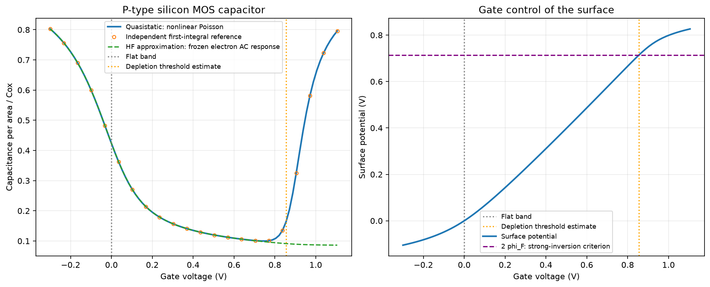
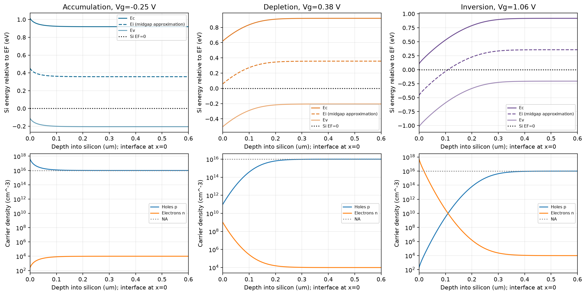
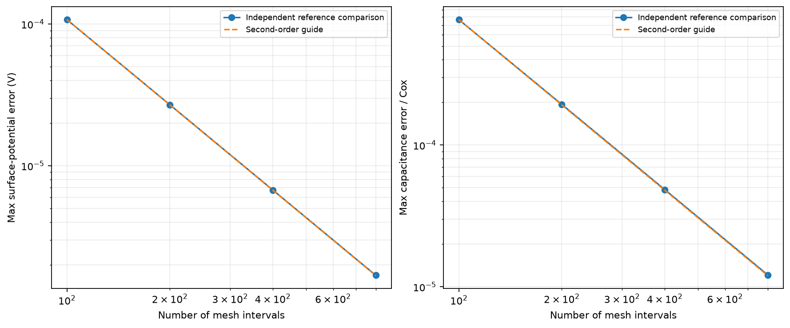
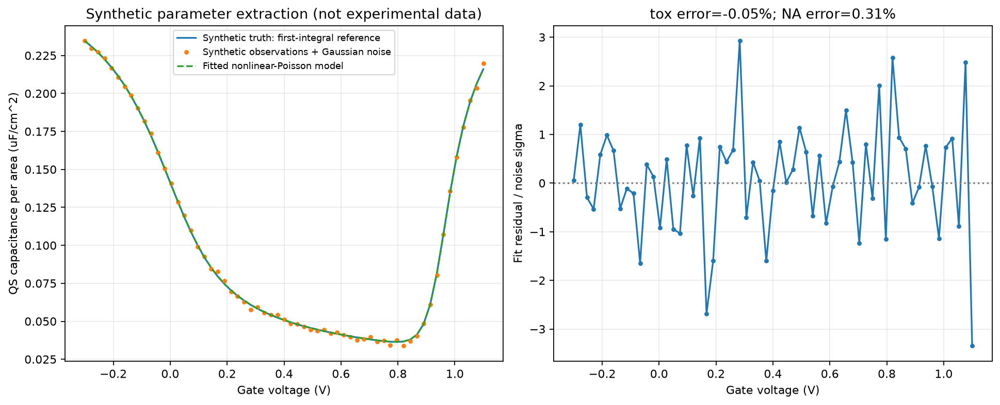

# mini-tcad-moscap

一维 MOS 电容自洽仿真、C-V 分析与合成数据参数反演。面向已经学过 PN 结、希望复现一个有物理与数值方法深度的项目的同学。

MOS Capacitor（Metal-Oxide-Semiconductor Capacitor，金属-氧化物-半导体电容）通过栅压控制半导体表面电荷，是理解场效应器件的基础。本项目属于教学型 TCAD（Technology Computer-Aided Design，工艺与器件计算机辅助设计）：用物理方程和数值方法研究器件行为。



项目已完成：非线性泊松自洽求解、积累/耗尽/反型、硅中能带与载流子分布、准静态 C-V、冻结电子交流响应的高频近似、585 个参数扫描点、网格收敛、合成噪声数据的厚度/掺杂提取，以及 13 项测试。

## 一键复现

需要 Python 3.10 或更新版本：

```bash
git clone https://github.com/carveself/mini-tcad-moscap.git
cd mini-tcad-moscap
python -m venv .venv
```

激活虚拟环境，按系统选一行：

```bash
# macOS / Linux
source .venv/bin/activate
# Windows PowerShell
# .venv\Scripts\Activate.ps1
```

```bash
python -m pip install -r requirements.txt
python run_all.py
python -m unittest discover -s tests -v
```

所有图像自动保存到 `figures/`，合成数据保存在 `figures/data/`。绘图采用无窗口模式，重复运行覆盖同名结果。数值结果可有很小的浮点差异，比较时使用容差。

改变基准参数或输出目录：

```bash
python run_all.py --na 2e16 --tox 8 --temperature 300 --output reproduction/custom
python run_all.py --nodes 801 --fit-nodes 401 --output reproduction/fine
```

`--na` 为 cm⁻³，`--tox` 为 nm，温度为 K。默认结果路径相对于项目根目录，指定的相对路径相对于当前工作目录。参数提取始终运行一个独立、固定的合成算例；改变基准参数不会偷偷改变提取实验的真实值。文件中的电容均为单位面积电容，单位 F/m²；乘 100 转为 μF/cm²。

## 建议阅读顺序

| 文件 | 用途 |
| --- | --- |
| [分阶段复现教程](docs/REPRODUCE.md) | 从参考公式、单偏压到完整求解与反演，每步有检查点 |
| [模型与方程](docs/MODEL.md) | 符号、边界、离散、雅可比矩阵、C-V 和模型边界 |
| [五页项目报告](docs/REPORT.pdf) / [文字版](docs/REPORT.md) | 问题、方法、结果、验证和局限 |
| [五分钟讲解与追问](docs/INTERVIEW.md) | 按时间分配的讲解稿、常见问题和动手练习 |
| `src/moscap.py` | 自洽求解器与独立第一积分参考解 |
| `src/experiments.py` | 图像、参数扫描、阈值与验证指标 |
| `src/parameter_extraction.py` | 对数参数拟合、残差和局部不确定度 |
| `src/stages.py` | 分阶段运行入口 |
| `src/build_report.py` | 可选的五页 PDF 生成器 |
| `tests/test_moscap.py` | 13 项物理与数值测试 |

## 相比 PN 结项目增加了什么？

Poisson equation（泊松方程）把空间电荷密度与静电势联系起来。这里的电子、空穴浓度随电势指数变化，因此电荷本身也是未知电势的函数。这形成了 Self-consistent solution（自洽解）：电势和载流子必须同时满足同一个物理模型。

代码使用 Boltzmann statistics（玻尔兹曼统计）计算载流子，以 Newton-Raphson method（牛顿-拉夫逊法）迭代求解非线性方程，使用阻尼控制步长，并用前一个栅压的解作为下一个栅压的初值。数值内部势分布没有使用参考解初始化。

Depletion approximation（耗尽近似）忽略耗尽区内的移动载流子，用于阈值电压的解析估计；本项目的主要数值解保留电子和空穴。Accumulation（积累）表示表面多数载流子增加，Depletion（耗尽）表示它们被排开，Inversion（反型）表示表面少数载流子占优势。三种状态的硅能带与载流子图可以直接比较：



## C-V 与高频模型的含义

C-V（Capacitance-Voltage，电容-电压）分析研究栅电荷对栅压的微分响应。Quasistatic capacitance（准静态电容）假设载流子充分响应缓慢变化的栅压，由数值解的线性化灵敏度计算，并用电荷中心差分独立检查。

图中的 HF（High Frequency，高频）曲线采用一个明确的近似：保留直流反型电荷，在交流线性化时冻结电子浓度的变化，仅保留空穴响应。它不是指定某个 Hz 的频率扫描，也没有求解载流子动态、产生复合或界面陷阱；详见模型文档。

## 实际验证结果

默认基准：P 型硅、受主浓度 $`N_A=10^{16}`$ cm⁻³、氧化层厚度 10 nm、300 K、功函数差与固定氧化层电荷为零。非均匀网格 401 点，主 C-V 扫描 85 点。

| 指标 | 默认运行结果，约值 |
| --- | ---: |
| 氧化层单位面积电容 | 0.00345313 F/m² |
| 耗尽近似阈值 | 0.8553336 V |
| 数值提取阈值 | 0.8553347 V |
| 相对独立参考解的最大表面电势误差 | 9.73 μV |
| 最大 C-V 误差 / 氧化层电容 | 0.00598% |
| 最大归一化非线性残差 | $`1.76\times10^{-10}`$ |
| 最大离散电荷守恒误差 | $`3.53\times10^{-13}`$ C/m² |
| 自动测试 | 13 项通过 |

参考解来自半无限硅中的泊松方程第一积分与标量求根，数值解来自有限深度的非均匀网格离散和牛顿迭代。它们没有共用空间离散。101、201、401、801 点的误差呈现接近二阶收敛。



完整残差、电荷平衡、阈值、边界电场和载流子统计适用性筛查均记录在 `figures/validation.json`。增大计算域的检查同时改变网格间距，因此明确记作“深度与网格的联合敏感性”，不将它冒充纯边界截断误差。

## 合成数据参数提取

Parameter extraction（参数提取）从曲线反推器件参数。这里的观测数据由独立参考解生成，加入固定随机种子 20261019 的高斯噪声；噪声标准差为真实氧化层电容的 0.4%。逆问题使用 301 点网格的非线性泊松求解器，拟合氧化层厚度与受主浓度。

| 参数 | 合成真实值 | 提取值 | 相对误差 |
| --- | ---: | ---: | ---: |
| 氧化层厚度 | 12 nm | 11.99425 nm | -0.0479% |
| 受主浓度 | $`1.2\times10^{16}`$ cm⁻³ | $`1.20369\times10^{16}`$ cm⁻³ | +0.3075% |



温度、功函数差、固定氧化层电荷及面积归一化在这个实验中视为已知。图、CSV 和 JSON 均明确写明 SYNTHETIC；它们不是实验室测量数据。给出的局部线性化不确定度有模型和已知参数假设，单次噪声实验的误差不是对其他数据的精度保证。

## 模型范围与可以继续扩展的方向

- 一维、经典、均匀 P 型硅；理想绝缘氧化层、完全电离、固定介电常数；忽略隧穿、量子限域和简并修正。
- 输入范围为掺杂 $`10^{15}`$ 到 $`10^{17}`$ cm⁻³、厚度 5-40 nm、温度 250-400 K；完整三状态演示还要求估计阈值相对平带电压不超过 1.75 V，以遵守偏压保护范围。
- 计算每个偏压下载流子浓度与有效态密度的比值，以 0.05 作为经典统计适用性的提示阈值。默认曲线负栅压端及部分扫描点略超出此保守阈值，结果用于教学趋势；这些点的离散误差很小不代表物理模型同样精确。
- 能带只绘制硅内部，近似把本征能级放在禁带中间；没有画氧化层的真实带阶。
- 高频曲线是冻结电子交流响应的近似，未包含频率依赖和交流输运。后续可加入费米-狄拉克统计、动态小信号方程或界面陷阱模型。

核心结果在 Python 3.12、NumPy 2.3.5、SciPy 1.18.1、Matplotlib 3.11.2 上验证。依赖声明给出兼容范围；精确版本记录在 `docs/VALIDATION.md`。

## 重建报告（可选）

报告不是运行仿真的前置条件。要从仓库中的文字版重建 PDF：

```bash
python -m pip install -r requirements-report.txt
python src/build_report.py
```

可通过 `--font /path/to/font.ttf` 指定支持中文的 TrueType 字体。生成器只支持本项目报告所使用的 Markdown 子集，默认输出为 `docs/REPORT.pdf`。修改参数后，应同步修改报告文字中的基准结果，再重新生成；程序不会把旧文字数字伪装成新参数的验证记录。

## 参考资料

- [TU Graz：MOS 电容与泊松方程教学示例](https://lampz.tugraz.at/~hadley/psd/L10/moscap_poisson.php)：电荷、势与能带关系。
- [MIT 6.012：MOS Capacitors II](https://ocw.mit.edu/courses/6-012-microelectronic-devices-and-circuits-fall-2009/2a94c4436b68993a04ad47bda22eb067_MIT6_012F09_lec10.pdf)：栅电荷、电容和阈值的课程背景。

这是已完成的参考实现。复现时建议保留原版，在自己的分支中按教程逐步重写，并记录每次修改的物理依据与验证结果。
