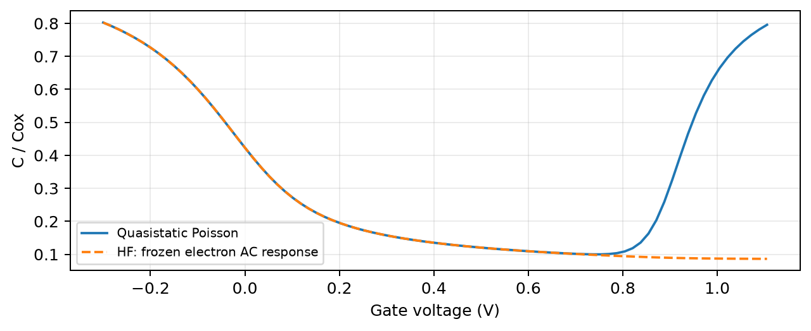
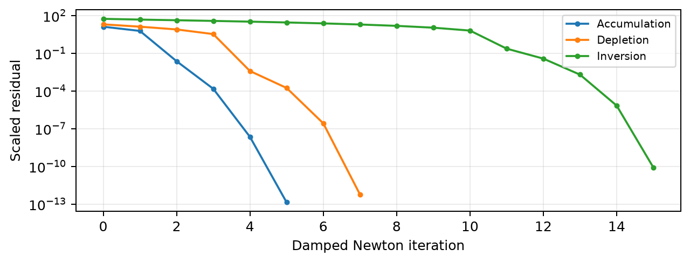
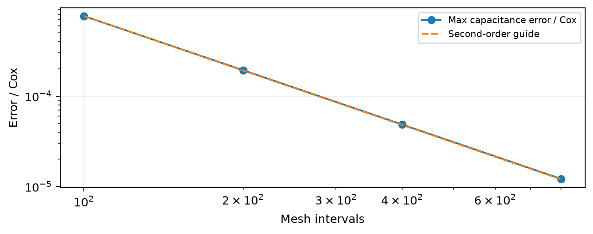
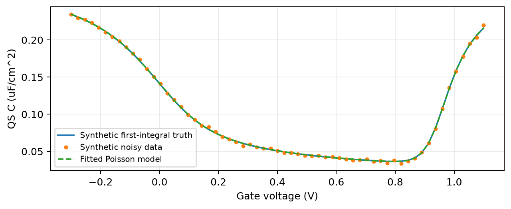

# 一维 MOS 电容自洽仿真与参数提取

项目技术报告 | 基准版本 v1 | 2026-10-19

## 1. 研究问题与基准器件

MOS Capacitor 是 Metal-Oxide-Semiconductor Capacitor，即金属-氧化物-半导体电容。本项目研究栅压如何控制 P 型硅的表面电势、电子与空穴分布，以及单位面积电容。它在 PN 结入门项目之后，引入了载流子与电势的非线性自洽关系。

| 基准参数 | 数值 |
| --- | --- |
| P 型硅受主浓度 | 1.0e16 cm^-3 |
| 氧化层厚度 / 温度 | 10 nm / 300 K |
| 功函数差 / 固定氧化层电荷 | 0 V / 0 C/m^2 |
| 氧化层单位面积电容 Cox | 0.00345313 F/m^2 |
| 主网格 / 主 C-V 点数 | 401 点 / 85 点 |

负栅压吸引空穴形成积累，正栅压先形成耗尽，继续升高后出现电子反型层。准静态响应允许少数载流子充分调整。高频曲线采用冻结电子交流密度的近似，没有对应指定的测量频率。

交付物包括求解器、独立参考解、参数扫描、13 项测试、7 张主结果图、原始数据、分阶段复现教程和五分钟讲解材料。

<!-- page -->

# 2. 物理模型与数值方法

界面取 x=0，正方向进入硅，体区电势为零。完全电离条件下，体区满足 p0-n0=NA 与 p0*n0=ni^2。采用玻尔兹曼统计：p=p0*exp(-psi/VT)，n=n0*exp(psi/VT)，rho=q*(p-n-NA)。泊松方程为 -eps_si*psi''=rho，因此电势和电荷需要同时迭代。

栅侧使用罗宾边界，表达氧化层和半导体之间的电压分配；后边界接地。平带电压 VFB=phi_ms-Qox/Cox。计算域深度由德拜长度与最大耗尽宽度共同设置，非均匀网格在界面附近加密。

节点有限体积离散在内部控制区间和界面半格上积分电荷。解析雅可比为三对角矩阵，通过带状线性求解器计算牛顿步；步长限制和回溯阻尼保证残差下降。偏压扫描使用前一解作初值，独立三状态演示从零初值开始。

电容通过线性化离散方程计算 dpsi/dVg，再得到 C=dQg/dVg；测试还使用栅电荷中心差分核对。高频近似保留直流电子电荷，但在交流雅可比中只保留空穴响应。

数值支路不使用独立参考电势初始化。指数超出安全范围的试探步被拒绝；没有通过裁剪浓度来改变方程。详细离散式见同目录 MODEL.md，源代码以 SI 单位计算。

<!-- page -->

# 3. 独立验证与误差分析

参考解来自半无限硅的泊松第一积分，片电荷为表面势的函数，再用标量求根满足栅压关系；它不使用空间网格。数值解则来自有限深度的节点有限体积与非线性牛顿迭代。

| 验证量 | 默认结果，约值 |
| --- | --- |
| 最大表面势误差 | 9.73e-6 V |
| 最大电容误差 / Cox | 5.98e-5，即 0.00598% |
| 最大归一化非线性残差 | 1.76e-10 |
| 最大离散电荷平衡误差 | 3.53e-13 C/m^2 |
| 耗尽近似 / 数值阈值 | 0.8553336 / 0.8553347 V |

101、201、401、801 点的加密结果接近二阶收敛。电荷守恒检查使用 Qg+Qox+Qs-D_bulk；保留有限域后边界通量，避免把非零边界电场误当成缺失电荷。

13 项测试覆盖平带、电荷中性、三种状态、独立参考、电容导数、雅可比方向导数、网格收敛、固定电荷位移、初值续接、反演恢复及输入保护。增加深度的检查保持节点数不变，因此明确归类为深度与网格的联合敏感性，而非纯边界误差。

<!-- page -->

# 4. 从合成 C-V 数据反推器件参数

用独立第一积分模型生成 61 个 C-V 数据点，加入标准差为真实 Cox 的 0.4% 的高斯噪声，随机种子固定为 20261019。数据明确标记为合成数据，不是实验室测量。

逆模型使用 301 点的非线性泊松求解器，在对数空间拟合氧化层厚度和受主浓度。温度、功函数差、固定氧化层电荷与面积归一化视为已知。真实厚度和掺杂不作为残差函数的初值或约束中心。

| 参数 | 合成真实值 | 提取结果 | 相对误差 |
| --- | --- | --- | --- |
| 氧化层厚度 | 12 nm | 11.99425 nm | -0.0479% |
| 受主浓度 | 1.2e16 cm^-3 | 1.20369e16 cm^-3 | +0.3075% |

最优点的约化卡方约 1.32，对数参数相关系数约 -0.54；局部相对一倍标准差约为厚度 0.155%、掺杂 0.416%。这些量来自最优点附近线性化，条件是所选模型与其他已知参数正确。

单个种子的提取误差不代表实测精度或一般性能。可以继续改变噪声、偏压覆盖范围、初值或已知功函数，研究参数可辨识性与系统误差。

<!-- page -->

# 5. 模型边界、复现与展示

## 模型边界

本项目是经典一维静电模型，忽略量子限域、隧穿、简并统计、界面陷阱和动态载流子连续性方程。温度材料参数经过室温标定，硅本征能级近似放在禁带中央。

浓度/有效态密度的比值以 0.05 作为保守筛查阈值。默认负栅压端与部分扫描点略超过阈值，提示经典统计的物理精度边界；数值误差很小不能消除这一模型误差。所有筛查值与原始数值一起保存。

高频曲线采用冻结电子交流密度近似，不能声称已经预测某个具体频率下的实验曲线。合成反演假设其他参数已知，未证明同时拟合面积、功函数、固定电荷等未知量时仍能唯一提取。

## 复现路线

先运行 python run_all.py 和 13 项测试，建立基准；再按 REPRODUCE.md 完成 reference、profiles、cv、extract 四个检查点。每一步都要说明符号、单位、边界和误差来源。主参数扫描有 585 个求解点，结果均可从 CSV 与 JSON 核对。

复现后的个人扩展可选：更换噪声种子；删除积累或反型区数据；多初值反演；检查网格对反演的影响；引入功函数偏差。先写预测，再跑实验，再记录解释与失败案例。

## 五分钟展示重点

依次展示研究问题、非线性方程与边界、独立参考和收敛、合成数据提取、模型局限与个人扩展。应明确参考实现来源和自己实际复现、重写、排错及验证的部分。

## 资料与可追溯记录

项目仓库：https://github.com/carveself/mini-tcad-moscap

物理背景：TU Graz, MOS Capacitor - Solving the Poisson Equation；MIT 6.012, Lecture 10, MOS Caps II。完整可点击链接见主 README。

默认验证环境：Python 3.12 / NumPy 2.3.5 / SciPy 1.18.1 / Matplotlib 3.11.2。精确运行结果以 figures/validation.json 和 figures/extraction.json 为准。本报告描述提交的默认基准；改变参数后应重新生成结果并更新文字。
